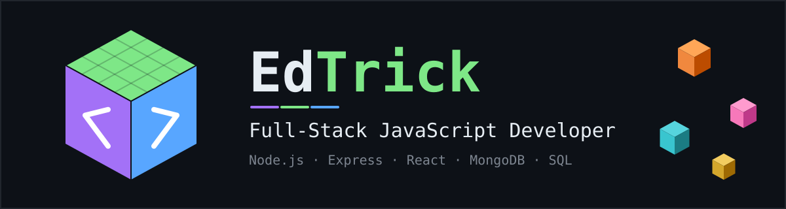

 

<a href="#about">About</a> &nbsp;·&nbsp;
<a href="#tech-stack">Tech stack</a> &nbsp;·&nbsp;
<a href="#github-stats">GitHub stats</a> &nbsp;·&nbsp;
<a href="#contribution-activity">Activity</a>

  

 

## About

Full-stack developer focused on building solid, maintainable web applications. I've been working with **JavaScript**, **Node.js**, **Express.js**, **MongoDB** and **SQL** for quite some time, and I care about clean code, clear structure and well-designed APIs.

**What I work with**

- **Back end:** REST APIs and server-side applications with Node.js and Express.js
- **Front end:** component-based user interfaces with React
- **Data:** document-oriented modelling in MongoDB and relational design with SQL
- **Languages:** JavaScript as my daily driver, plus Java

 

## Tech stack

<table>
  <tr>
    <td><b>Languages</b></td>
    <td></td>
  </tr>
  <tr>
    <td><b>Back end</b></td>
    <td></td>
  </tr>
  <tr>
    <td><b>Front end</b></td>
    <td></td>
  </tr>
  <tr>
    <td><b>Databases</b></td>
    <td></td>
  </tr>
  <tr>
    <td><b>Tools</b></td>
    <td></td>
  </tr>
</table>

 

## GitHub stats

  

 

## Contribution activity

